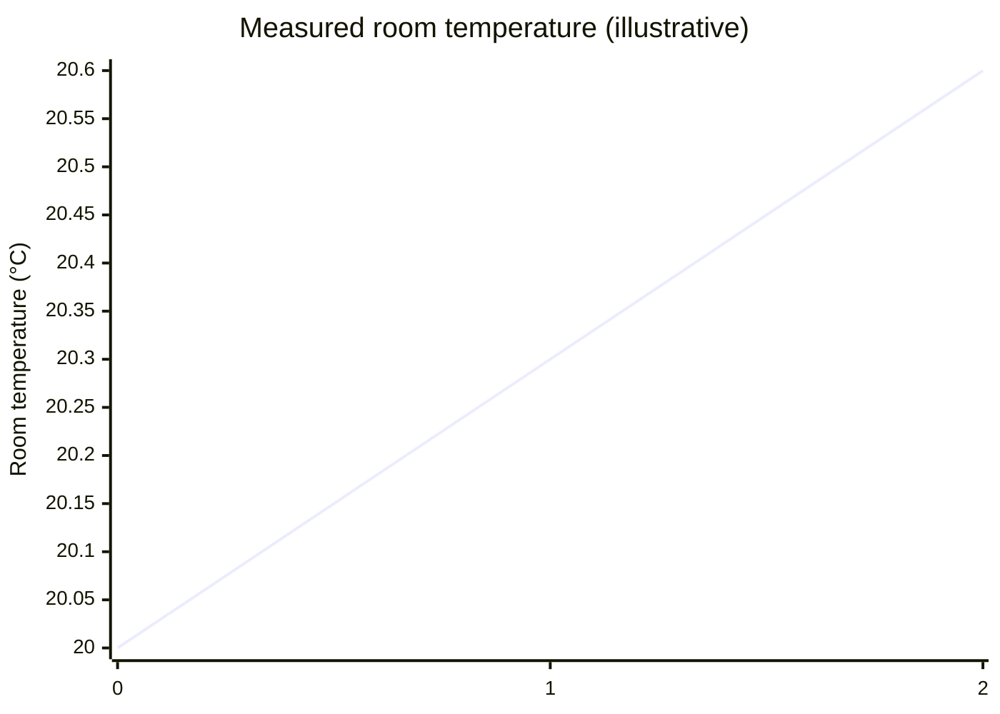
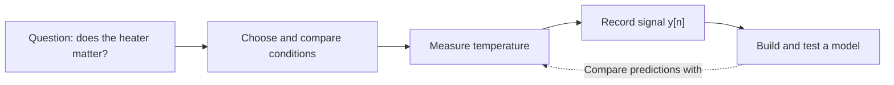

# Measurement, Experiment, and Signal

_A map is not the territory. But before we can draw a useful map, we must decide what to look for, how to observe it, and what our observations will mean._

Consider a room. We may describe it with a floor plan, a photograph, a list of objects, or its temperature over time. These are not competing versions of reality. They preserve different aspects of the same place because they answer different questions.

Scientific data begin with the same choice. We decide what we want to learn and what would count as an observation. Three ideas help us move from the world to a useful representation: __measurement__, __experiment__, and __signal__. They often work together, but they are not three compulsory steps of a single process.

## Measurement: choosing what a number describes

Suppose we ask, _How warm is this room?_ We need more than a number. We must choose the quantity to measure, where and when to measure it, a unit, and an instrument or procedure.

A thermometer might report 20.0 °C. That is a measurement result, not a piece of the room itself. Another position in the room, a different sensor, or a different calibration might give another value. Some differences describe the room; others come from how we measured it.

The quantity we intend to measure is called the __measurand__. We must also consider instrument resolution, calibration, repeatability, and uncertainty. These are not reasons to distrust every measurement; they explain what a measurement can reasonably support. In metrology, measuring a quantity is more specific than merely recording a category such as _door open_ or _door closed_.

Like the cartographer's choice of scale, the measurement procedure is designed. But once specified, it produces results that others can check, repeat, and challenge. Our choices do not make their consequences arbitrary.

## Experiment: learning by comparing conditions

Now ask a different question: _Does switching on the heater raise the room's temperature?_ A thermometer alone cannot answer it. We need observations under conditions that make the comparison meaningful.

We might record the temperature with the heater off and again with it on, keeping the sensor position and measurement schedule the same. To strengthen the experiment, we would repeat the trials and consider what else could change the result: sunlight, open windows, people in the room, or the thermometer's response time.

The experiment defines the conditions in which observations are produced. __Changing a factor deliberately__ gives us a way to investigate its effect, although a single before-and-after comparison does not establish causation by itself. An observational study can also produce valuable measurements without manipulating the conditions; its conclusions have different limits.

We do not experiment merely to collect more numbers. We design comparisons so that the numbers can help distinguish explanations.

## Signal: preserving how something varies

A single thermometer reading tells us something about one moment. Several readings, kept in their order, can reveal change.

Let $T(t)$ represent the room's temperature as a function of time. We may not know this continuous-time function exactly. A logger records observations at chosen times $t_{[n]} = n\Delta t$, where $\Delta t$ is the sampling interval. Its recorded values form a discrete-time signal $y_{[n]}$.

A __signal__ is a way of representing how a quantity or property varies with an independent variable. That variable may be time, but it could also be position, distance, or another coordinate. An image, for example, can represent brightness across two spatial coordinates. Signals can be measured, calculated, or simulated; not every signal is an experimental recording.

If we kept only the average temperature, we would lose the order of the observations. The average might still be a useful map for one purpose, but it could not tell us _when_ the heater began to warm the room. The signal preserves a kind of structure that the summary discards.

## One small map, three perspectives

For a simple model of our thermometer, suppose the readings are recorded in degrees Celsius:

```math
y_{[n]} = T(t_{[n]}) + b + \varepsilon_{[n]}.
```

Here $T(t_{[n]})$ is the temperature we wish to know, $b$ is a constant measurement bias, and $\varepsilon_{[n]}$ represents the remaining measurement error. We are __assuming__ this model for the example; it is not a universal law of thermometers.

Imagine the logger records 20.0 °C, 20.3 °C, and 20.6 °C at one-minute intervals. These are invented illustrative readings, not experimental evidence. The measured change from the first to the third reading is 0.6 °C.


_Figure: three discrete measurements, generated from [the sample CSV](https://github.com/JulTob/Data/blob/docs/measurement-experiment-signal-20261106/Visualizacion/figures/thermometer_samples.csv) with [reproducible plotting code](https://github.com/JulTob/Data/blob/docs/measurement-experiment-signal-20261106/Visualizacion/scientific_figures.py). The dots represent recorded samples in this invented example, not a known continuous temperature trajectory. The image uses a review-branch URL; replace it with the accepted permanent asset location when incorporating this draft into the Wiki._

A compact, editable Mermaid XY version is possible if the actual Wiki supports the XY chart syntax, but its connecting line is only a visual guide between sample points (not an observation of intermediate values):



Under our model:

```math
y_{[2]}-y_{[0]} = T(t_{[2]})-T(t_{[0]}) + \varepsilon_{[2]}-\varepsilon_{[0]}.
```

Notice that the constant bias $b$ disappears from the difference. __That conclusion follows objectively from the model's assumptions.__ If the bias drifts with time, the cancellation may no longer hold. And even a genuine rise in temperature would not, by itself, show that the heater caused it.

We can now see the distinct contributions:

- __Measurement__ defines how we obtain the temperature readings and what errors may affect them.
- __Experiment__ defines the conditions we compare to investigate the heater's effect.
- __Signal__ preserves the readings' order so we can study how the temperature changes.

For this particular experiment, the workflow can be drawn as:



The arrows describe this example, not a universal definition of measurement, experiment, or signal.

## From measured data to possible events

Suppose we repeat the experiment and ask whether the measured temperature rises by at least 0.5 °C in two minutes. We have defined an __event__: the set of runs in which that condition is met. Each run gives us an observed result; a probability model can assign a weight to the event before we know whether the next run will satisfy it.

This is where our maps lead naturally into probability and statistics. We do not need to see every instant, every molecule, or every possible future to reason about the room. But we must remember which details our measurements and models have left out.

__We choose what to observe. We design how to test it. We represent how it varies. Then we ask whether the map continues to agree with the world.__

## Sources

- Joint Committee for Guides in Metrology, _International Vocabulary of Metrology_ (VIM): [2.1 Measurement](https://jcgm.bipm.org/vim/en/2.1.html), [2.3 Measurand](https://jcgm.bipm.org/vim/en/2.3.html), and [2.26 Measurement uncertainty](https://jcgm.bipm.org/vim/en/2.26.html). Terminology, measurands, and uncertainty.
- NIST/SEMATECH, _Engineering Statistics Handbook_: [4.3.1 Design of Experiments](https://www.itl.nist.gov/div898/handbook/pmd/section3/pmd31.htm) and [2.1.1 Measurement Process Characterization](https://www.itl.nist.gov/div898/handbook/mpc/section1/mpc11.htm). Experimental comparisons and measurement quality.
- Alan V. Oppenheim, MIT OpenCourseWare, [Signals and Systems, Lecture 1: Introduction](https://ocw.mit.edu/courses/res-6-007-signals-and-systems-spring-2011/resources/lecture-1-introduction/). Mathematical representation of signals and systems.
